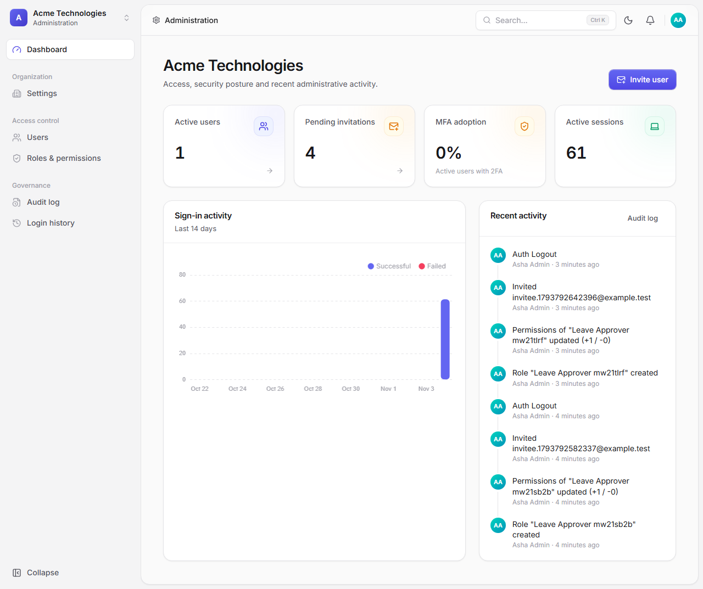
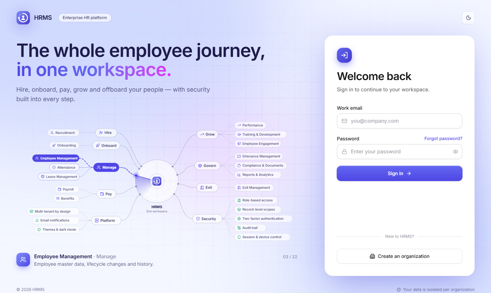
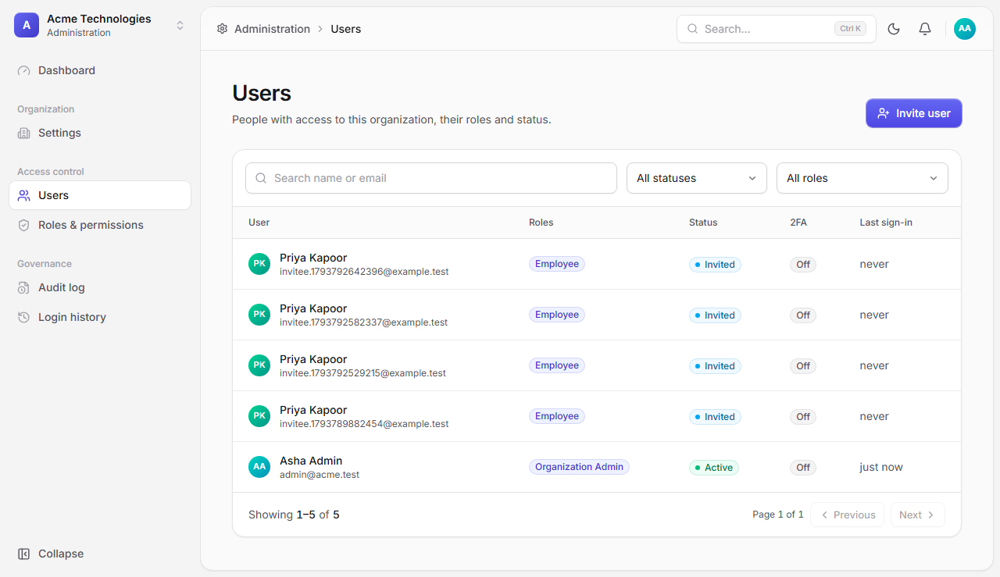
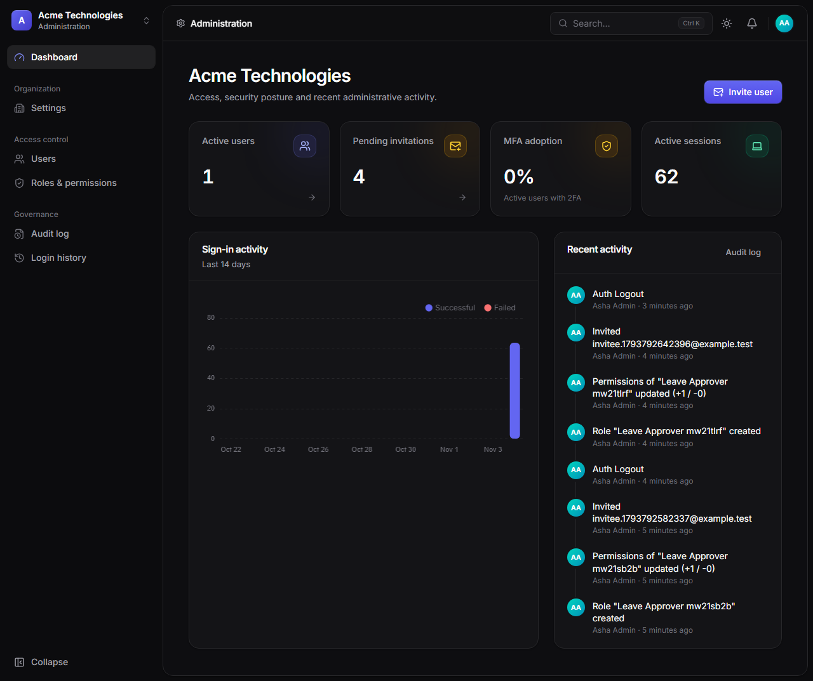
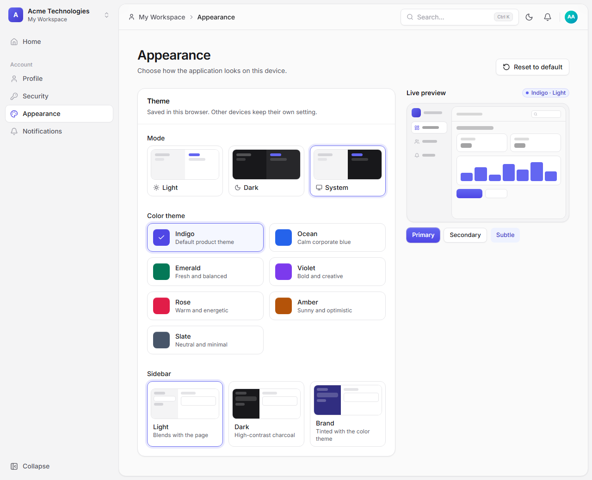
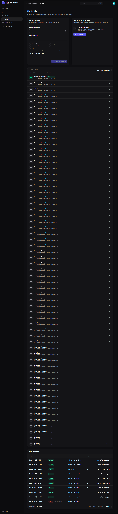
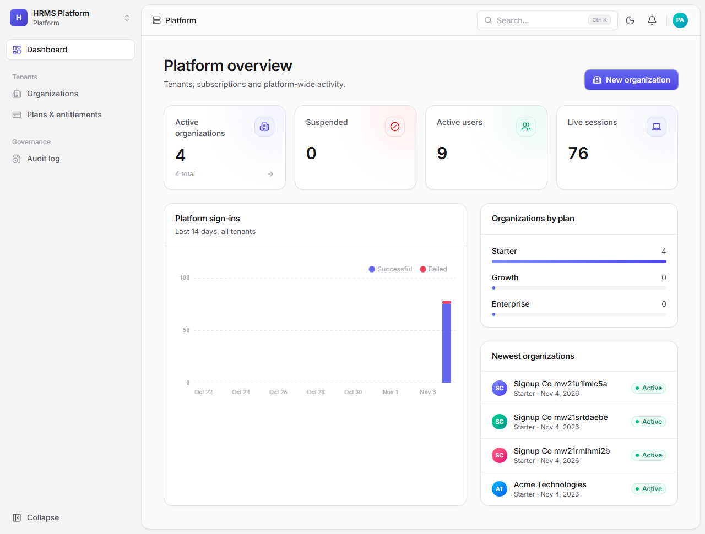
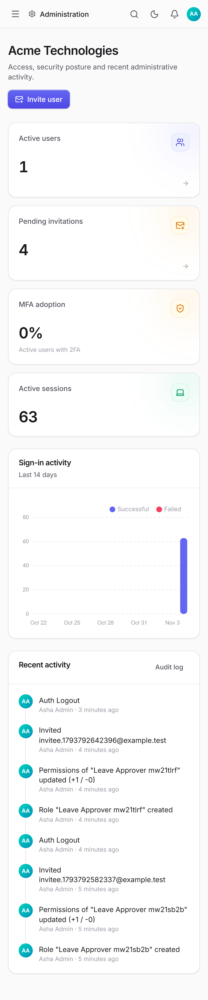
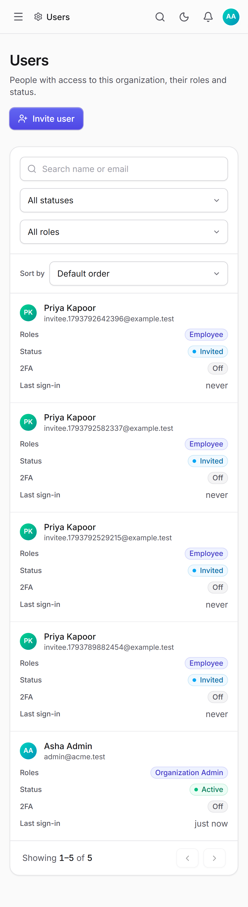

# HRMS – Enterprise Human Resource Management System

Multi-tenant SaaS HRMS covering the complete employee lifecycle. **Phase 1 (foundation)** is complete: authentication with MFA, sessions, multi-tenancy, plans & entitlements, RBAC, audit, notifications, design system and the four workspaces.



| | |
|---|---|
|  |  |
|  |  |
|  |  |
|  |  |

## Quick start

`backend/` and `frontend/` are independent npm projects (each has its own `node_modules` and `package-lock.json`).

```bash
cd backend
npm install
cp .env.example .env                    # DB_NAME/DB_USER/DB_PASSWORD/DB_HOST/DB_PORT, secrets, SUPERADMIN_* credentials
cp .env.test.example .env.test          # test database for the integration/E2E suites
npm run db:migrate && npm run db:seed
npm run start:dev                       # API http://localhost:3000/api/v1 · docs /api/docs

# second terminal
cd frontend
npm install
cp .env.example .env                    # API base path, dev-server port and proxy target
npm run dev                             # web http://localhost:5173
```

Full instructions: [docs/DEPLOYMENT.md](docs/DEPLOYMENT.md).

## Repository

| Path | Contents |
|---|---|
| `backend` | NestJS REST API, Sequelize models, SQL migrations (Umzug), integration tests. `src/contracts` holds the permission catalog, role templates, API types and password rules that the frontend also compiles (imported there as `@contracts`) |
| `frontend` | Vue 3 SPA, design system, themes, Playwright E2E |
| `docs` | Product, functional, architecture, database, API, RBAC, security, deployment, testing docs |

## Scripts

The root `package.json` only holds commitlint (dev); its other scripts run the matching script inside each folder.

| Command (from the root) | Purpose |
|---|---|
| `npm run install:all` | `npm install` in backend and frontend |
| `npm run dev:backend` / `npm run dev:frontend` | API in watch mode / Vite dev server (run in two terminals) |
| `npm run build` | Build backend and frontend |
| `npm run typecheck` | Type-check backend and frontend |
| `npm run db:migrate` / `npm run db:seed` | Apply SQL migrations / seed development data |
| `npm run test` | Backend unit, backend integration, frontend unit tests |
| `npm run test:e2e:frontend` | Build the backend, then run Playwright end-to-end tests |
| `npm run docs:rbac` | Regenerate the RBAC matrix in `docs/RBAC.md` |
| `npm run hooks:install` | Check commit messages locally (Conventional Commits) with the `.githooks/commit-msg` hook |

## Commits

Commit messages follow [Conventional Commits](https://www.conventionalcommits.org): `type(scope): summary`, for example `feat(payroll): pay settlements by bank file` or `fix(auth): refuse breached passwords`. Types: `feat`, `fix`, `docs`, `refactor`, `perf`, `test`, `build`, `ci`, `chore`, `revert`; scopes are the module names in `commitlint.config.cjs`. CI checks every commit in a pull request.

## Documentation

[User guide](docs/USER_GUIDE.md) · [PRD](docs/PRD.md) · [FRD](docs/FRD.md) · [Architecture](docs/ARCHITECTURE.md) · [Design decisions](docs/DECISIONS.md) · [Database](docs/DATABASE.md) · [API](docs/API.md) · [RBAC](docs/RBAC.md) · [Security](docs/SECURITY.md) · [Deployment](docs/DEPLOYMENT.md) · [Testing](docs/TESTING.md) · [Changelog](docs/CHANGELOG.md)
