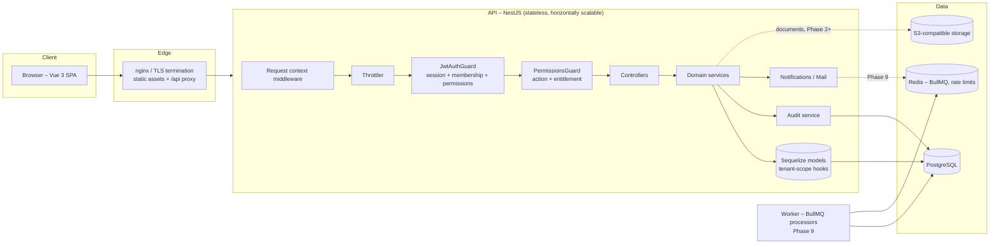

# Architecture

## 1. Overview

HRMS is a multi-tenant SaaS built as a **modular monolith**: one deployable API with strictly separated domain modules, one SPA, and shared contracts. This keeps transactions simple (payroll, leave and attendance need cross-module consistency) while leaving clean seams to extract services later.



| Layer | Technology (pinned) | Notes |
|---|---|---|
| Frontend | Vue 3.5, TypeScript 5.9, Vite 7, Tailwind CSS 4, Pinia 3, Vue Router 4, Chart.js 4, Lucide icons | SPA, lazy-loaded routes, design-system components |
| Backend | Node.js 22+, NestJS 11, **Sequelize 6.37 + sequelize-typescript 2.1**, Umzug 3 (migrations), pg 8, class-validator, @nestjs/swagger 11, @nestjs/throttler 6 | REST `/api/v1`, OpenAPI at `/api/docs` |
| Database | PostgreSQL 16+ (developed on 18, CI on 17) | UUID keys, `timestamptz`, composite tenant FKs |
| Infra | Redis 7, BullMQ 5 (Phase 9), Docker, S3-compatible storage (MinIO locally), GitHub Actions | |
| Testing | Jest 29 + Supertest (API), Vitest 3 (web/shared), Playwright 1.64 (E2E) | |

Newer majors exist (NestJS 12, TypeScript 7, Vitest 5; Sequelize 7 is still pre-release). The pinned versions are the latest releases of the most recent **proven-compatible** majors; upgrades are tracked in the CHANGELOG.

## 2. Repository structure

```
HRMS/
├── package.json                 helper scripts only (no dependencies, no workspaces)
├── docker-compose.yml           postgres, redis, minio, migrate(+bootstrap), backend, frontend
├── .env.docker.example          compose infrastructure secrets (Postgres, Redis, MinIO)
├── .dockerignore                build context rules for frontend/Dockerfile (root context)
├── .github/workflows/ci.yml     typecheck → unit → integration (Postgres) → build → Playwright → images
├── docs/                        PRD, FRD, ARCHITECTURE, DATABASE, API, RBAC, SECURITY, DEPLOYMENT, TESTING, CHANGELOG
├── backend/                     @hrms/backend – NestJS REST API (independent npm project)
│   ├── package.json, package-lock.json, node_modules/
│   ├── .env(.example) .env.test(.example) .env.docker(.example)   backend-only environment
│   ├── Dockerfile, .dockerignore, nest-cli.json, tsconfig*.json, jest.config.js
│   ├── scripts/rbac-matrix.js             generates the docs/RBAC.md matrix
│   ├── src/
│   │   ├── main.ts, bootstrap.ts, app.module.ts
│   │   ├── contracts/                     shared with the frontend ('@contracts'); framework-free
│   │   │   ├── permissions.ts             permission catalog, modules, scopes
│   │   │   ├── roles.ts                   system role templates
│   │   │   ├── api.ts                     response envelope, error codes, AccessContext
│   │   │   └── password-policy.ts         password rules (enforced here, previewed in the UI)
│   │   ├── cli/bootstrap.ts               production-safe platform bootstrap
│   │   ├── config/                        env validation (fail fast) + typed AppConfig
│   │   ├── common/                        auth decorators, request context, errors, filters,
│   │   │                                  interceptors, pagination, validation, utils
│   │   ├── database/                      Sequelize layer
│   │   │   ├── models/                    sequelize-typescript models (identity, organization, rbac, activity)
│   │   │   ├── tenant-scope.ts            tenant-isolation hooks (auto-scoping, fail-closed)
│   │   │   ├── migrations/*.up|down.sql   SQL migrations (Umzug)
│   │   │   ├── migrator.ts, migrate.ts    migration runner + CLI (up | down | status | baseline)
│   │   │   ├── database.service.ts        connection, transactions, raw selects
│   │   │   └── seed.ts                    development seed
│   │   ├── infrastructure/                crypto, mail, audit, platform bootstrap helpers
│   │   └── modules/
│   │       ├── auth/                      login, MFA, sessions, tokens, policies, guards
│   │       ├── rbac/                      access resolution, roles, catalog sync, escalation
│   │       ├── users/                     memberships, invitations
│   │       ├── organizations/             profile, security policy, subscription, provisioning
│   │       ├── platform/                  super-admin: tenants, plans, entitlements
│   │       ├── audit/                     audit-log & login-event queries
│   │       ├── notifications/             in-app notifications
│   │       └── health/
│   └── test/                              Supertest integration suites + helpers
├── frontend/                    @hrms/frontend – Vue 3 SPA (independent npm project)
│   ├── package.json, package-lock.json, node_modules/
│   ├── .env(.example) .env.e2e .env.production   frontend-only environment (no secrets)
│   ├── Dockerfile, nginx.conf, vite.config.ts, playwright.config.ts, tsconfig*.json
│   ├── src/                     see "Frontend source layout" below
│   └── e2e/                     Playwright specs + global setup
```

### Frontend source layout

```
frontend/src/
├── main.ts, App.vue, env.d.ts
├── app/                         application wiring (no feature logic)
│   ├── router/index.ts          router instance + guard (auth, restricted session, access rules, titles)
│   ├── router/routes.ts         route table: layouts (workspaces) hosting module routes
│   └── styles/                  main.css (tokens, Tailwind theme), themes.css (color palettes)
├── core/                        cross-cutting singletons used by every module
│   ├── http/http-client.ts      fetch wrapper: envelope, ApiError, refresh-and-retry, ListQuery
│   ├── auth/                    auth.store.ts (tokens, context, permissions), use-access-subject.ts
│   ├── navigation/              access-rules.ts (shared evaluator), workspaces.ts (menus, landing pages)
│   └── theme/                   themes.ts (catalog), theme.store.ts, use-theme-palette.ts,
│                                components/ThemeSwitcher.vue
├── shared/                      reusable, feature-agnostic building blocks
│   ├── components/              UI library – import from '@/shared/components'
│   │   ├── forms/               AppButton, AppInput, AppSelect, AppTextarea, AppCheckbox, AppSwitch,
│   │   │                        AppFormField, AppPasswordChecklist
│   │   ├── data/                AppDataTable, AppPagination, AppBadge, AppAvatar, AppStatCard
│   │   ├── feedback/            AppAlert, AppModal, AppConfirmDialog, AppToaster, AppSkeleton,
│   │   │                        AppEmptyState, AppErrorState
│   │   ├── layout/              AppCard, AppPageHeader, AppTabs, AppDropdown, AppMenuItem
│   │   ├── types.ts, index.ts   SelectOption/TableColumn + barrel
│   ├── composables/             use-async, use-table, use-form-errors
│   ├── stores/                  ui.store (sidebar, drawer, search), feedback.store (toasts, confirm)
│   └── utils/                   format, redirect, options, status
├── layouts/                     Auth, Platform, Admin, Hr, Ess layouts
│   └── shell/                   AppShell, AppSidebar, AppTopbar, GlobalSearch, NotificationBell
└── modules/                     one folder per business domain
    └── <module>/                auth, account, notifications, organization, users, roles, audit, hr,
        ├── api/<module>.api.ts  platform, errors
        ├── types.ts             DTOs returned by the module's endpoints
        ├── <module>.routes.ts   pages the module contributes to a workspace
        ├── pages/               routed views (*Page.vue)
        ├── components/          module-only components
        └── utils/               module-only helpers (optional)
```

**Dependency direction:** `modules → shared, core` and `layouts → shared, core`; `shared` never imports from `modules`; modules import another module only for its `types.ts` / `api` (e.g. `users` uses `roles/types`). New domains (employees, leave, payroll…) are added as new `modules/<domain>/` folders plus one line in `app/router/routes.ts` and a menu entry in `core/navigation/workspaces.ts`.

**Naming conventions**

| Kind | Convention | Example |
|---|---|---|
| Folders | kebab-case, singular domain name | `modules/organization/`, `shared/composables/` |
| Vue components | PascalCase; shared library prefixed `App` | `AppDataTable.vue`, `PermissionMatrix.vue` |
| Routed views | PascalCase ending in `Page` | `UserDetailPage.vue` |
| Layouts | PascalCase ending in `Layout` | `AdminLayout.vue` |
| Stores | `<name>.store.ts` exporting `use<Name>Store` | `theme.store.ts` → `useThemeStore` |
| Composables | `use-<name>.ts` exporting `use<Name>` | `use-table.ts` → `useTable` |
| API clients | `<module>.api.ts` exporting `<module>Api` | `users.api.ts` → `usersApi` |
| Routes | `<module>.routes.ts` exporting `<module>Routes` | `roles.routes.ts` → `rolesRoutes` |
| Tests | next to the code, `*.spec.ts` | `theme.store.spec.ts` |

### Theming

Three independent preferences, persisted per browser (`localStorage`) and applied before first paint by an inline script in `index.html`:

* **Mode** – light, dark or system (follows the OS setting live). Toggles the `dark` class on `<html>`.
* **Color theme** – Indigo (default), Ocean, Emerald, Violet, Rose, Amber, Slate. Sets `data-theme` on `<html>`; `themes.css` defines the `--brand-50…950` scale per theme and Tailwind maps `brand-*` utilities to those variables, so every component re-colors without code changes. Shades 600+ are chosen for ≥ 4.5:1 contrast with white text.
* **Sidebar style** – Light (default, blends with the page), Dark (charcoal) or Brand (tinted with the color theme). Sets `data-sidebar` on `<html>`; `main.css` defines the `--app-sidebar-*` palette per style.

Users switch from the account menu (quick switcher), the topbar light/dark toggle, or **My Workspace → Appearance** (mode tiles, color cards, sidebar previews and a live preview built from the real tokens). Charts read the active palette through `useThemePalette()`. To add a color theme: add a `[data-theme='<key>']` block to `themes.css` and an entry to `COLOR_THEMES` in `core/theme/themes.ts`.

### Design language

* **Tokens** (`app/styles/main.css`): zinc-based neutrals, `canvas` (page panel) vs `surface` (cards) vs `app` (shell), hairline borders, layered `shadow-card` / `shadow-pop`, 8–16 px radii. Components use semantic utilities only (`bg-surface`, `text-fg-muted`, `border-line`, `bg-sidebar-active`, …), so dark mode and themes need no component changes.
* **Typography**: Inter Variable, self-hosted via `@fontsource-variable/inter` (no external requests); tight tracking on headings; sentence-case labels (no all-caps).
* **Shell**: inset layout – the page panel floats on the sidebar color; workspace/organization switcher in the sidebar header; topbar with breadcrumbs (workspace › page), search (Ctrl K), theme toggle, notifications and account menu.
* **Components**: gradient primary buttons with a highlight edge, soft tinted badges and icon chips, segmented tabs, custom selects/checkboxes/switches, stat cards with optional trend and link, timeline activity lists, toasts bottom-right, modals as bottom sheets on phones. Motion respects `prefers-reduced-motion`.

Planned modules (Phase 2+) follow the same layout: `modules/<domain>/{controller, service(s), dto, *.spec.ts}` with calculation engines in pure, separately-tested services (e.g. `payroll/engine/*`).

## 3. Request lifecycle

1. **RequestContextMiddleware** creates an `AsyncLocalStorage` context: request id (`X-Request-Id`), IP, user agent.
2. **ThrottlerGuard** applies rate limits (global 300/min/IP; stricter on auth endpoints).
3. **JwtAuthGuard** verifies the access token, loads the **session** (revocation is immediate), checks the user is active, then resolves **membership, roles, permissions and entitlements** for the session's organization from the database. It writes `userId` / `organizationId` into the request context.
4. **PermissionsGuard** enforces `@RequirePermissions`, `@RequirePlatformPermissions`, `@RequireTenant` and module entitlement.
5. **ValidationPipe** (whitelist + forbid unknown fields) validates DTOs.
6. Controllers are thin; **services** hold business logic and query Sequelize models, which are **tenant-scoped automatically** by model hooks.
7. **ResponseEnvelopeInterceptor** wraps results as `{ success, data, meta? }`; **AllExceptionsFilter** maps errors to `{ success:false, error:{ code, message, details?, requestId } }` without leaking internals.

## 4. Multi-tenancy design

**Model:** shared database, shared schema, `organization_id` on every tenant-owned row.

Defence in depth:

| Layer | Control |
|---|---|
| Identity | Users are global; access to an organization requires an `ACTIVE` membership in an `ACTIVE` organization, re-checked **on every request**. |
| Token | The access token carries `oid` (session organization). It must equal the session's current organization, otherwise the token is rejected (prevents stale tokens after an organization switch). |
| Client input | Organization ids supplied by clients (login `organizationId`, `switch-organization`) are honoured only after membership validation. Tenant APIs never accept an organization id parameter — the context comes from the session. |
| ORM | Sequelize hooks on every tenant model (`database/tenant-scope.ts`) AND the request's organization into every find/count/update/destroy, assign or verify `organizationId` on create/save, reject cross-tenant writes and **fail closed** (`TenantIsolationError`) when no tenant context exists. Identity, platform and bootstrap code must opt out explicitly with `skipTenantScope: true`, so the safe behaviour is the default. A unit test asserts every model with a required `organizationId` is registered in `TENANT_MODELS`. |
| Database | Composite foreign keys (`(role_id, organization_id) → roles(id, organization_id)`, same for memberships) make cross-tenant role assignment impossible even with a buggy query. |
| Errors | Cross-tenant ids return **404**, never 403, to avoid confirming existence. |
| Tests | `tenant-isolation.e2e-spec.ts` attacks every Phase 1 endpoint with another tenant's ids. |

Platform (Super Admin) services opt out of tenant scoping explicitly (`skipTenantScope: true`) and are protected by platform permissions. Organization lifecycle: `PENDING → ACTIVE ⇄ SUSPENDED → DEACTIVATED (→ ACTIVE)`; suspension/deactivation revokes all sessions in the organization.

**Entitlements:** plan → `plan_features`; per-organization overrides in `organization_features` (force on/off). Core modules are always on. Effective entitlements are resolved per request and filter the permission set.

Row-level security (PostgreSQL RLS keyed on a `SET LOCAL app.organization_id`) is planned as an additional layer in Phase 10 once transaction-scoped context is introduced for all tenant queries.

## 5. Authentication design (summary)

See [SECURITY.md](SECURITY.md) for full detail.

* Email + password (Argon2id) → optional TOTP MFA challenge (5-minute challenge JWT) → session.
* **Access token**: HS256 JWT, 15 min, in memory only (never localStorage). Claims: `sub`, `sid`, `oid`.
* **Refresh token**: 256-bit opaque value, stored as SHA-256, sent as `HttpOnly; Secure; SameSite=Strict; Path=/api/v1/auth` cookie, **rotated on every use** with **reuse detection** (replay revokes the session). Idle timeout and absolute lifetime come from the organization security policy.
* Sessions are first-class rows: listable, revocable by the user, by admins (per organization), and automatically on password change/reset, suspension and organization suspension.
* Restricted sessions: when MFA is mandated but not enrolled, or the password has expired, only security endpoints are reachable.

## 6. Frontend architecture & navigation

Four workspaces (separate layouts sharing `AppShell`), each with its own permission-filtered menu. Menu items, routes and the global search share one access-rule evaluator (`core/navigation/access-rules.ts`); the API remains the authority.

| Workspace | Layout | Access | Phase 1 pages | Planned (phase) |
|---|---|---|---|---|
| **Platform** `/platform` | PlatformLayout | Super Admin | Dashboard, Organizations (list/detail: status, plan, entitlements, admins), Plans, Platform audit log | Billing & usage (10) |
| **Administration** `/admin` | AdminLayout | any of `organization.update`, `organization.security.manage`, `user.view`, `role.view`, `audit.view`, `audit.login_history.view` | Dashboard, Organization settings (profile, security policy, subscription), Users (+detail), Roles & permissions (+matrix editor), Audit log, Login history | Structure: branches, locations, departments, designations, grades, cost centers, holidays (2); Automation settings (9) |
| **HR Operations** `/hr` | HrLayout | HR permissions at TEAM scope or wider | HR dashboard (module access, pending invitations) | Employees (2); Recruitment, Onboarding (3); Attendance, Leave (4); Payroll (5); Performance, Training (6); Engagement, Grievances, Benefits (7); Compliance, Exits (8); Reports (9) |
| **My Workspace** `/me` | EssLayout | every signed-in user | Home, Profile, Security (password, MFA, sessions, sign-in history), Appearance (themes), Notifications | My attendance & check-in, leave, payslips, letters, training, grievances, reviews, reimbursements (2–8) |

Responsive by design (tested at desktop, tablet and phone sizes): below 1024 px the sidebar becomes a drawer (Escape/backdrop/navigation closes it; hidden from keyboard and screen readers while closed); below 768 px `AppDataTable` renders each row as a labelled card with a "Sort by" menu (explicit ARIA table roles keep semantics); below 640 px the permission matrix stacks the scope control under each permission; modals become bottom sheets. Pages must never scroll horizontally – wide content scrolls inside its own container.

UX building blocks: collapsible sidebar (persisted), mobile drawer, 7 color themes × light/dark/system mode (no flash), Ctrl+K command palette (pages + users + organizations), notification bell with polling, toasts, confirmation dialogs (with type-to-confirm for destructive actions), skeletons, empty and error states (with request reference), accessible tabs/modals/menus (focus trap, Esc, ARIA roles, skip link).

## 7. Background jobs (Phase 9 design)

BullMQ on Redis ≥ 6.2: one queue per domain (`notifications`, `reminders`, `payroll`, `documents`), repeatable jobs for reminders, idempotency keys (`<type>:<org>:<entity>:<date>`), exponential backoff retries, a dead-letter queue, failure logging to `job_failures`, and a monitoring view. Jobs run in a separate worker process using `RequestContext.runForTenant()` so tenant models stay scoped. Business-critical jobs never rely on frontend timers.

> The local Windows Redis is 3.0.504, which BullMQ does not support. Use the Redis 7 container from `docker-compose.yml` (or Memurai on Windows) before Phase 9.
