# Database Design

PostgreSQL, accessed through **Sequelize 6** with **sequelize-typescript** models (`backend/src/database/models/`). The schema is owned by versioned **SQL migrations** run with **Umzug** (`backend/src/database/migrations/*.up.sql` / `*.down.sql`); models never `sync()` the schema.

| Task | Command (from `backend/`) |
|---|---|
| Apply pending migrations | `npm run db:migrate` (dev) · `node dist/database/migrate.js up` (production) |
| Revert the last migration | `npm run db:migrate:down` |
| Show status | `npm run db:migrate:status` |
| Adopt an existing schema (e.g. created by the earlier Prisma migrations) | `npm run db:migrate:baseline` – records migrations as applied without running SQL |
| Seed development data | `npm run db:seed` |

Applied migrations are tracked in `schema_migrations`. Each migration runs in its own transaction. To add a migration, create `YYYYMMDDHHMMSS_<name>.up.sql` (+ `.down.sql`), then update the matching model.

## 1. Conventions

| Rule | Implementation |
|---|---|
| Primary keys | `uuid`, generated application-side (`DataType.UUIDV4`) |
| Naming | snake_case tables (plural) and columns; models use `underscored: true` so attributes stay camelCase |
| Models | `Model<InferAttributes<T>, InferCreationAttributes<T>>`; associations typed `NonAttribute<…>`; `User`'s default scope hides credentials (`User.scope('withSecrets')` to read them) |
| Timestamps | `created_at`, `updated_at` as `timestamptz(3)` on every mutable table |
| Actors | `created_by_id`, `updated_by_id` FK → `users(id)` `ON DELETE SET NULL` on business tables |
| Tenancy | `organization_id` on **every** organization-owned row (including join tables); `UNIQUE (id, organization_id)` on parents so children can use **composite FKs** that pin the child to the same tenant; tenant models are auto-scoped by Sequelize hooks (see ARCHITECTURE §4) |
| Effective dating | business rules that change over time (statutory rates, salary, policies, assignments) use `effective_from` / `effective_to` (Phase 2+) |
| History | separate append-only history tables for employment, salary, department, designation, manager, policy changes and payroll corrections (Phase 2+); the generic `audit_logs` table records every administrative change with a field diff |
| JSON | only where the shape is genuinely variable: `audit_logs.changes/metadata`. Never as a substitute for relations |
| Money | `numeric(12,2)` (payroll will use `numeric(14,2)`) – never floating point |
| Sensitive data | encrypted application-side with AES-256-GCM (`v1:<iv>:<tag>:<ciphertext>`), e.g. `users.mfa_secret_enc`; bank accounts, PAN, Aadhaar (Phase 2) follow the same pattern plus a `*_last4` column for display/search |
| Secrets | passwords: Argon2id; high-entropy tokens (refresh, reset, invitation, recovery codes): SHA-256 — raw values are never stored |
| Deletion | users and organizations are never hard-deleted (status transitions); audit logs are append-only (DB trigger) |

## 2. Phase 1 ER diagram

```mermaid
erDiagram
  users ||--o{ organization_memberships : "belongs to"
  users ||--o{ user_sessions : has
  user_sessions ||--o{ refresh_tokens : rotates
  users ||--o{ action_tokens : "reset / invite"
  users ||--o{ password_history : keeps
  users ||--o{ mfa_recovery_codes : has
  users ||--o{ login_events : generates
  users ||--o{ notifications : receives
  users ||--o{ audit_logs : "acts in"

  plans ||--o{ plan_features : includes
  features ||--o{ plan_features : ""
  plans ||--o{ organizations : subscribes
  organizations ||--o{ organization_features : overrides
  features ||--o{ organization_features : ""
  organizations ||--|| organization_security_policies : has
  organizations ||--o{ organization_memberships : has
  organizations ||--o{ roles : defines
  organizations ||--o{ audit_logs : scopes
  organizations ||--o{ login_events : scopes

  roles ||--o{ role_permissions : grants
  permissions ||--o{ role_permissions : ""
  organization_memberships ||--o{ membership_roles : assigned
  roles ||--o{ membership_roles : ""

  users {
    uuid id PK
    varchar email UK
    text password_hash "argon2id, null until invite accepted"
    enum status "ACTIVE|DISABLED"
    enum platform_role "SUPER_ADMIN|null"
    bool mfa_enabled
    text mfa_secret_enc "AES-256-GCM"
    int mfa_last_used_step "TOTP replay guard"
    int failed_login_count
    timestamptz locked_until
    timestamptz password_changed_at
    uuid last_organization_id FK
  }
  organizations {
    uuid id PK
    varchar slug UK
    enum status "PENDING|ACTIVE|SUSPENDED|DEACTIVATED"
    uuid plan_id FK
    char country "ISO-3166"
    varchar timezone "IANA"
    char currency "ISO-4217"
    smallint fiscal_year_start_month
  }
  organization_memberships {
    uuid id PK
    uuid organization_id FK
    uuid user_id FK
    enum status "INVITED|ACTIVE|SUSPENDED"
  }
  roles {
    uuid id PK
    uuid organization_id FK
    varchar key "unique per org"
    bool is_system
    bool is_locked
  }
  role_permissions {
    uuid organization_id "composite FK with role_id"
    uuid role_id FK
    uuid permission_id FK
    enum scope "OWN|TEAM|DEPARTMENT|ORGANIZATION"
  }
  membership_roles {
    uuid organization_id "composite FKs"
    uuid membership_id FK
    uuid role_id FK
  }
  permissions {
    uuid id PK
    varchar key UK
    varchar module
    varchar page
    bool is_scopable
    bool is_restricted
  }
  user_sessions {
    uuid id PK
    uuid user_id FK
    uuid organization_id FK "active org"
    timestamptz expires_at "absolute"
    timestamptz revoked_at
  }
  refresh_tokens {
    char token_hash UK "sha256"
    timestamptz expires_at "idle timeout"
    timestamptz used_at "rotation / reuse detection"
  }
  audit_logs {
    uuid organization_id
    uuid actor_user_id
    varchar action
    varchar entity_type
    jsonb changes "redacted diff"
    varchar request_id
  }
```

## 3. Phase 1 tables

| Table | Tenant-owned | Purpose |
|---|:-:|---|
| `users` | – | Global identity, credentials, MFA, lockout state |
| `password_history` | – | Last N hashes for reuse prevention |
| `mfa_recovery_codes` | – | Hashed single-use recovery codes |
| `user_sessions` | (org ref) | One row per sign-in; revocation, idle/absolute expiry |
| `refresh_tokens` | – | Rotating refresh tokens (hashed) |
| `action_tokens` | (org ref) | Password reset / invitation tokens (hashed, single use) |
| `login_events` | (org ref) | Sign-in history (success, failure reason, lockout, MFA challenge) |
| `features` | – | Module catalog (synced from code) |
| `plans`, `plan_features` | – | Subscription plans and included modules |
| `organizations` | – | Tenant profile, regional settings, lifecycle |
| `organization_features` | ✓ | Per-tenant entitlement overrides |
| `organization_security_policies` | ✓ | Password, lockout, session and MFA policy |
| `organization_memberships` | ✓ | User ↔ organization with status |
| `permissions` | – | Permission catalog (synced from code) |
| `roles`, `role_permissions`, `membership_roles` | ✓ | RBAC with record scope |
| `audit_logs` | ✓ (nullable for platform events) | Append-only audit trail (UPDATE/DELETE blocked by trigger) |
| `notifications` | (org ref) | In-app notifications |

Migrations:

| Migration | Content |
|---|---|
| `20261104061517_init_foundation` | All Phase 1 tables, enums, indexes, composite FKs |
| `20261104063303_mfa_replay_protection` | `users.mfa_last_used_step` |
| `20261104064557_audit_log_append_only` | Trigger `audit_logs_append_only` rejecting UPDATE/DELETE |

## 4. Planned schema (Phases 2–9)

All tables below carry `organization_id`, audit columns and composite tenant FKs. Names are indicative; each phase finalises its schema in a migration and updates this document.

```mermaid
erDiagram
  organizations ||--o{ branches : has
  branches ||--o{ locations : has
  organizations ||--o{ departments : has
  departments ||--o{ departments : "sub-department"
  organizations ||--o{ designations : has
  organizations ||--o{ job_grades : has
  organizations ||--o{ cost_centers : has
  organizations ||--o{ holiday_calendars : has
  holiday_calendars ||--o{ holidays : contains

  employees ||--o| organization_memberships : "linked user (optional)"
  employees ||--o{ employment_records : "effective-dated: dept, designation, grade, manager, location, type"
  employees ||--o{ salary_assignments : "effective-dated"
  employees ||--o{ employee_contacts : emergency
  employees ||--o{ employee_addresses : has
  employees ||--o{ employee_education : has
  employees ||--o{ employee_experience : has
  employees ||--o{ employee_bank_accounts : "encrypted"
  employees ||--o{ employee_statutory_ids : "encrypted PAN/UAN/ESIC"
  employees ||--o{ employee_documents : "S3 objects, versioned"

  requisitions ||--o{ job_openings : approves
  job_openings ||--o{ applications : receives
  candidates ||--o{ applications : submits
  applications ||--o{ interviews : schedules
  interviews ||--o{ interview_feedback : collects
  applications ||--o| offers : releases
  offers ||--o| onboarding_cases : converts
  onboarding_cases ||--o{ onboarding_tasks : checklist

  shifts ||--o{ shift_assignments : "rotations"
  employees ||--o{ attendance_punches : raw
  employees ||--o{ attendance_days : "computed daily"
  attendance_days ||--o{ regularization_requests : corrects
  attendance_periods ||--o{ attendance_days : "monthly close"

  leave_types ||--o{ leave_policies : "effective-dated"
  employees ||--o{ leave_ledger_entries : "accrual/usage/carry/encash"
  employees ||--o{ leave_requests : applies
  leave_requests ||--o{ approval_steps : "configurable chain"

  salary_structures ||--o{ salary_components : defines
  statutory_rule_sets ||--o{ statutory_rules : "PF/ESI/PT/TDS slabs, effective-dated"
  payroll_runs ||--o{ payroll_items : "per employee"
  payroll_items ||--o{ payroll_item_lines : "earnings/deductions"
  payroll_runs ||--o{ payroll_adjustments : "post-approval corrections"
  payroll_items ||--o| payslips : generates
  employees ||--o{ loans : "recoveries"
  employees ||--o{ reimbursement_claims : submits

  performance_cycles ||--o{ goals : contains
  performance_cycles ||--o{ reviews : contains
  reviews ||--o{ review_responses : "self/manager/peer/360"
  courses ||--o{ training_sessions : schedules
  training_sessions ||--o{ enrollments : has
  grievance_cases ||--o{ case_events : history
  benefit_plans ||--o{ benefit_enrollments : has
  policies ||--o{ policy_versions : versioned
  policy_versions ||--o{ policy_acknowledgements : signed
  exit_cases ||--o{ clearance_items : requires
  exit_cases ||--o| settlements : "full & final"
```

Key rules carried into later phases:

* **Effective dating** for employment, salary, statutory rules and policies: `(organization_id, subject_id, effective_from)` unique; queries resolve "as of date".
* **Leave balances** are derived from an append-only ledger (`leave_ledger_entries`), never stored as a mutable counter.
* **Payroll** status machine `DRAFT → CALCULATED → VALIDATED → REVIEWED → APPROVED → PAID → CLOSED`; approved runs are immutable (DB trigger + service checks); corrections go to `payroll_adjustments` / reversal runs.
* **POSH cases** live in the grievance tables with a `restricted` flag and are only readable with `grievance.posh.access`.
