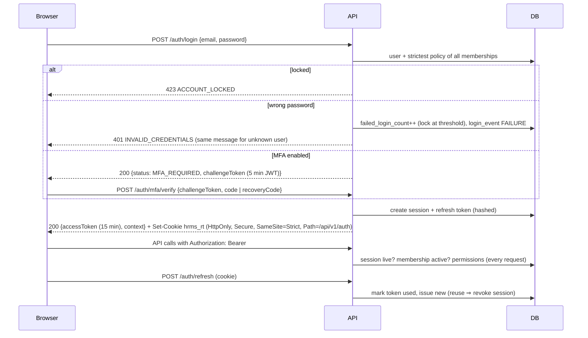

# Security

## 1. Authentication design

| Control | Implementation |
|---|---|
| Password hashing | Argon2id (m=19 MiB, t=2, p=1 – OWASP baseline); constant-time dummy verification for unknown users |
| Password policy | Per organization: min length (floor 8), upper/lower/number/symbol, history (reuse prevention), max age, plus "must not contain name/email". A user in several organizations gets the **strictest** combination. Shared validator gives the UI live feedback; the API is authoritative |
| Lockout | After N failures (policy) the account locks for M minutes; locked attempts are logged; the user is notified in-app and by email |
| MFA | TOTP (RFC 6238, 30 s, ±1 step) via authenticator apps; secret encrypted with AES-256-GCM; **replay protection** (last accepted time-step stored); 10 single-use recovery codes (SHA-256); organizations can **require MFA** – unenrolled users get a restricted session limited to security endpoints; disabling requires password + code and is blocked when required |
| Access token | HS256 JWT, 15 min, audience `hrms:access`, issuer `hrms-api`; carries only `sub`, `sid`, `oid`; kept in memory by the SPA |
| Refresh token | 256-bit random, stored as SHA-256, HttpOnly cookie scoped to `/api/v1/auth`; **rotated on each use**; **replay ⇒ whole session revoked** + audit event; idle timeout = policy, absolute lifetime = min(policy, `REFRESH_TOKEN_TTL_DAYS`); cross-tab refresh serialised with the Web Locks API |
| Sessions | Server-side rows; list & revoke own sessions; admins revoke a user's sessions in their organization; automatic revocation on password change (other sessions), password reset (all), membership suspension, organization suspension/deactivation, account disable |
| Password reset | Always-202 response (no enumeration); single-use 30-minute token (hashed); previous tokens invalidated; resetting revokes all sessions and unlocks the account; security notification |
| Invitations | Single-use 72-hour token; new users set a password under policy; existing accounts confirm their current password to join |
| CSRF | Access token is a bearer header (not a cookie). The refresh cookie is `SameSite=Strict` and path-scoped; CORS allow-list with credentials |

## 2. Authorization & tenant isolation

See [RBAC.md](RBAC.md) and [ARCHITECTURE.md §4](ARCHITECTURE.md#4-multi-tenancy-design). Highlights: permissions resolved per request from the DB; deny by default; module entitlements; record scopes; escalation prevention; restricted POSH permission; tenant-scoped ORM client that fails closed; composite tenant FKs; 404 for foreign ids.

## 3. Data protection

| Data | Protection |
|---|---|
| Passwords | Argon2id |
| Refresh/reset/invite tokens, recovery codes | SHA-256 (high-entropy inputs) |
| MFA secrets (now); bank accounts, PAN, Aadhaar, UAN (Phase 2) | AES-256-GCM, random 96-bit IV, auth tag, key-version prefix (`v1:`) for rotation; key from `DATA_ENCRYPTION_KEY` (32 bytes, KMS/secret manager in production) |
| Audit trail | Append-only (`audit_logs_append_only` trigger), field-level diffs with sensitive fields redacted (`password`, `*hash`, `*secret*`, `*token*`, bank/PAN/Aadhaar) |
| Transport | HTTPS terminated at the edge; `COOKIE_SECURE=true` enforced in production; HSTS via helmet |
| Logs | No secrets or tokens logged; errors return a `requestId` for correlation instead of stack traces |

Privacy & employment regulations (India DPDP Act 2023, GDPR where applicable, POSH Act 2013): data minimisation in self-service, purpose-bound access via RBAC scopes, restricted POSH case access, audit of access to sensitive records (Phase 2 adds read-auditing for bank/statutory fields), retention policies and erasure workflows (Phase 10).

## 4. Application hardening

* **Validation**: global `ValidationPipe` with `whitelist` + `forbidNonWhitelisted` (mass-assignment protection), typed DTOs, IANA time-zone / ISO country & currency validation, sort-field whitelists.
* **Rate limiting**: global 300 req/min/IP; login & MFA 10/min; forgot/reset password & registration 5/min; refresh 30/min. In-memory store today; Redis-backed store when running multiple instances (Phase 10).
* **Headers**: `helmet` (HSTS, no-sniff, frame-ancestors, etc.) on the API; strict CSP and security headers in `frontend/nginx.conf`; `x-powered-by` disabled.
* **Errors**: one exception filter; Sequelize/DB errors (unique, foreign-key, empty result) mapped to safe codes (`CONFLICT`, `NOT_FOUND`); 5xx details only in server logs.
* **SQL**: all queries go through Sequelize with escaped values or named replacements; `LIKE` searches escape wildcards; no string-built SQL from user input.
* **Body size**: JSON limit 1 MB; file uploads (Phase 2) via pre-signed S3 URLs with content-type/size allow-lists and malware scanning hook.
* **Open redirects**: post-login redirects accept same-origin relative paths only.
* **Configuration**: environment validated at boot (fails fast on weak/missing secrets); `.env` files are git-ignored; production requires secure cookies and a SendGrid API key (sandbox mode refused). The SendGrid key should be a restricted *Mail Send*-only key; email click/open tracking is disabled so one-time links never pass through third-party redirects.
* **Dependencies**: pinned exact versions; npm `allowScripts` restricts install scripts to argon2 and esbuild.

## 5. Threat model (Phase 1 scope)

| Threat | Mitigation | Test |
|---|---|---|
| Credential stuffing / brute force | Rate limit, lockout, generic errors, MFA | `auth.e2e` lockout & throttle tests |
| Account enumeration | Same error for unknown user/wrong password; forgot-password always 202 | `auth.e2e` |
| Stolen refresh token | Rotation + reuse detection, HttpOnly cookie, idle/absolute expiry | `auth.e2e` replay test |
| Stolen access token | 15-minute TTL; session revocation checked per request | `auth.e2e` logout/revoke tests |
| TOTP replay | Last-used time-step tracking | `mfa.e2e` replay test |
| Cross-tenant data access | Tenant client, composite FKs, membership validation, 404s | `tenant-isolation.e2e` |
| Privilege escalation | Escalation checks on role edit/assign/manage, locked roles, self-edit ban, last-admin guard | `rbac.e2e` |
| Audit tampering | DB trigger blocks UPDATE/DELETE | `tenant-isolation.e2e` |
| Mass assignment | Whitelisted DTOs | `auth.e2e` profile test |

## 6. Backup & recovery

* PostgreSQL: daily full backups (`pg_dump -Fc` or managed snapshots) + continuous WAL archiving for point-in-time recovery (RPO ≤ 15 min, RTO ≤ 4 h targets). Backups encrypted at rest, stored in a separate account/region, retained 35 days.
* Restore drills quarterly into an isolated environment; verify with `node dist/database/migrate.js status` and the health endpoint.
* `DATA_ENCRYPTION_KEY` and JWT secrets are backed up in the secret manager — without the encryption key, encrypted columns cannot be recovered.
* Redis holds only rebuildable state (rate limits, queues); queue jobs are idempotent.

See [DEPLOYMENT.md](DEPLOYMENT.md) for commands.

## 7. Reporting vulnerabilities

Report suspected vulnerabilities privately to the security owner; do not open public issues. Include reproduction steps and the `requestId` from error responses where relevant.
